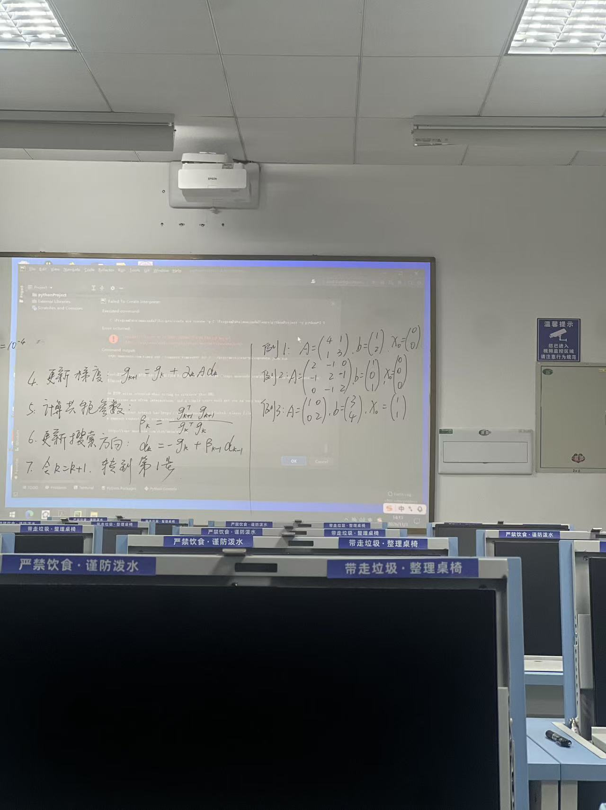
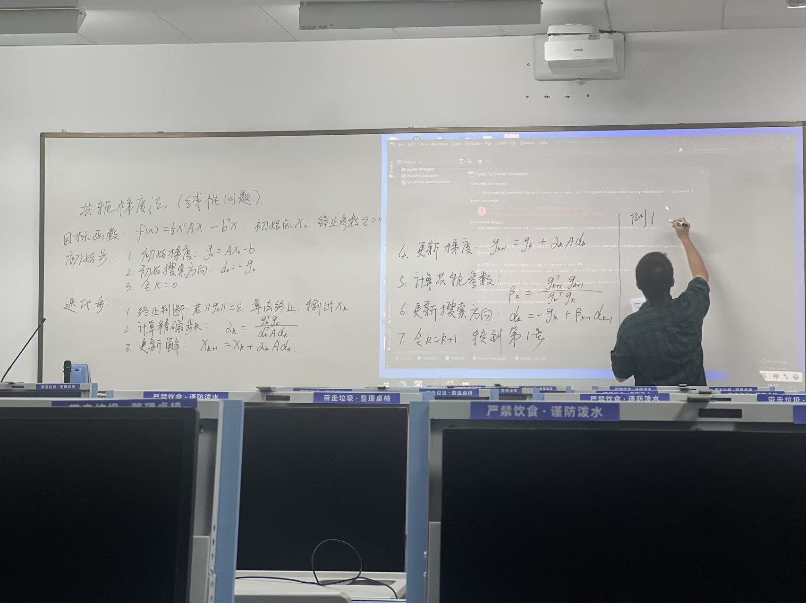

# 共轭梯度法课程笔记
整理日期：2026-11-03

## 课堂照片



## 1. 求什么
线性共轭梯度法求解对称正定矩阵的线性方程组 $Ax=b$，等价于最小化
$$f(x)=\frac12x^TAx-b^Tx.$$
梯度为 $g(x)=Ax-b$。梯度为零时得到唯一最优解。这里讨论线性共轭梯度法。

## 2. 白板算法整理
给定初始点 $x_0$、精度 $\varepsilon=10^{-4}$。
初始化 $g_0=Ax_0-b$，$d_0=-g_0$，$k=0$。
每轮：
1. 若 $\|g_k\|_2\le\varepsilon$，输出 $x_k$ 并停止。
2. 精确步长 $\alpha_k=(g_k^Tg_k)/(d_k^TAd_k)$。
3. 更新解 $x_{k+1}=x_k+\alpha_kd_k$。
4. 更新梯度 $g_{k+1}=g_k+\alpha_kAd_k$。
5. 共轭系数 $\beta_k=(g_{k+1}^Tg_{k+1})/(g_k^Tg_k)$。
6. 更新方向 $d_{k+1}=-g_{k+1}+\beta_kd_k$。
7. 令 $k\leftarrow k+1$，重复。

照片中的解更新式看起来多写了一个 A，正确式为第3步。照片方向公式使用 $d_k=-g_k+\beta_{k-1}d_{k-1}$，与第6步是相同递推关系，整理时统一了下标。
不同方向满足 $d_i^TAd_j=0$（$i\ne j$），称为 A 共轭。精确运算下至多 n 步收敛，浮点计算可能需要更多步。

## 3. 例1手算
$$A=\begin{pmatrix}4&1\\1&3\end{pmatrix},\quad b=\begin{pmatrix}1\\2\end{pmatrix},\quad x_0=\begin{pmatrix}0\\0\end{pmatrix}.$$
目标函数 $f(x)=2x_1^2+x_1x_2+\frac32x_2^2-x_1-2x_2$。

### 初始化
$g_0=(-1,-2)^T$，$d_0=(1,2)^T$，$\|g_0\|=\sqrt5$。

### 第一轮
$Ad_0=(6,7)^T$。
$$\alpha_0=\frac{1+4}{6+14}=\frac14.$$
$$x_1=(0,0)^T+\frac14(1,2)^T=(1/4,1/2)^T.$$
$$g_1=(-1,-2)^T+\frac14(6,7)^T=(1/2,-1/4)^T.$$
$$\beta_0=\frac{1/4+1/16}{5}=\frac1{16}.$$
$$d_1=(-1/2,1/4)^T+\frac1{16}(1,2)^T=(-7/16,3/8)^T.$$

### 第二轮
$$Ad_1=(-11/8,11/16)^T.$$
$$d_1^TAd_1=77/128+33/128=55/64.$$
$$\alpha_1=\frac{5/16}{55/64}=\frac4{11}.$$
$$x_2=(1/4,1/2)^T+\frac4{11}(-7/16,3/8)^T=(1/11,7/11)^T.$$
$$g_2=(1/2,-1/4)^T+\frac4{11}(-11/8,11/16)^T=(0,0)^T.$$
梯度为零，停止。最优解为 $x^*=(1/11,7/11)^T$。

## 4. 三道例题与结果
|例题|A|b|初始点|最优解|迭代次数|
|---|---|---|---|---|---|
|1|[[4,1],[1,3]]|[1,2]|[0,0]|[1/11,7/11]|2|
|2|[[2,-1,0],[-1,2,-1],[0,-1,2]]|[1,0,1]|[0,0,0]|[1,1,1]|2|
|3|[[1,0],[0,2]]|[3,4]|[1,1]|[3,2]|2|

结果向量的各项是未知数的值，不是目标函数最小值。例如例3表示 $x_1=3,x_2=2$。

## 5. VS Code 运行
打开本目录，选择 Python 解释器，在终端运行：
```powershell
python -m pip install -r requirements.txt
python conjugate_gradient.py
```
VS Code 可通过菜单“终端 → 新建终端”打开终端。

输出含义：
- k：已完成的更新次数；k=0 是初始状态。
- x：当前解。
- ||g||：梯度的二范数，满足精度后停止。
- alpha：本次沿搜索方向的步长。
- 5.590170e-01 表示 0.559017。
- 直接解对照：使用 NumPy 求解 Ax=b，与自行实现的算法核对。

## 6. 代码逐段理解
完整代码见 [conjugate_gradient.py](conjugate_gradient.py)。

### 数组和符号
`import numpy as np` 导入矩阵运算工具。
`np.asarray(..., dtype=float)` 将列表转成浮点数组。
`np.array(x0, ..., copy=True)` 复制初始点，避免修改调用者的数据。
`A @ x` 是矩阵乘向量；一维数组的 `g @ g` 是内积 $g^Tg$。
`A.T` 为转置；`np.linalg.norm(g)` 是向量长度。
`alpha * d` 为数乘。

### 函数输入与检查
`conjugate_gradient(A,b,x0,tol=1e-4,max_iter=None)` 接收题目数据、精度和迭代上限。
先检查维度、有限数值和对称性，通过 `np.linalg.cholesky(A)` 检查正定性。
默认迭代上限为 10n，用于给浮点运算留余量。

### 初始化与迭代
```python
g = A @ x - b
d = -g

# 每轮的数学计算（实际程序还包含收敛判断）
Ad = A @ d
alpha = (g @ g) / (d @ Ad)
x = x + alpha * d
g_new = g + alpha * Ad
beta = (g_new @ g_new) / (g @ g)
d = -g_new + beta * d
g = g_new
```
每行依次对应梯度、初始方向、矩阵乘方向、步长、新解、新梯度、共轭系数、新方向。
`x = x + alpha * d` 先计算右侧，再把新值存入 x，因此无需分别命名 x0、x1、x2。
保留 g 和 g_new 是因为 beta 同时需要旧梯度和新梯度。
更新后使用实际梯度 `A @ x - b` 再确认终止，避免仅依赖递推梯度。
`return x, k + 1` 将答案和已完成迭代次数交回调用处。
达到上限还未满足精度则抛出错误。

### 验证答案
`np.linalg.solve(A,b)` 计算对照解，`assert np.allclose(...)` 检查两种计算是否一致。共轭梯度本身没有调用直接求解器。

## 7. 为什么例题写在函数下面也能计算
定义函数和调用函数是两回事。Python 自上而下执行，遇到 def 先创建函数，函数体在调用时才执行：
```python
def add(a, b):
    return a + b

result = add(1, 2)
print(result)
```
先定义 add；执行 add(1,2) 时才进入函数；return 把3交回来；然后打印。

本程序的流程：
1. 定义共轭梯度函数（暂不求例题）。
2. 创建 examples 列表。
3. for 循环取出一道题的 A、b、x0。
4. 调用 conjugate_gradient，进入算法。
5. 得到返回的 x、steps，打印并核对。
6. 继续取下一题。

`if __name__ == "__main__":` 表示直接运行本文件才执行例题；其他文件导入该函数时，不会自动运行例题。
`enumerate(examples,1)` 为例题依次附上从1开始的编号。
所以实际计算顺序正是“取例题 → 调用算法 → 得到答案”。

## 8. 新增：与最速下降法比较
最速下降法每次取 $d_k=-g_k$，使用精确线搜索：
$$\alpha_k=\frac{g_k^Tg_k}{g_k^TAg_k},\qquad x_{k+1}=x_k-\alpha_kg_k.$$
共轭梯度法使用 $d_{k+1}=-g_{k+1}+\beta_kd_k$，结合上一轮方向构造 A 共轭方向。
两者第一步相同，从第二步开始方向可能不同。最速下降法可能出现折返、曲折逼近；共轭梯度在精确运算下至多 n 步收敛。

代码新增独立函数 `steepest_descent` 和末尾比较块。运行原脚本即可看到逐步过程和汇总。保持相同 A、b、初始点、梯度范数阈值 1e-4、最大次数10000，比较结果如下：

|例题|最速下降次数|共轭梯度次数|最速下降最终梯度范数|共轭梯度最终梯度范数|
|---|---|---|---|---|
|1|9|2|2.696e-5|0|
|2|28|2|8.632e-5|0|
|3|10|2|4.790e-5|4.441e-16|

解误差定义为与直接解的欧氏距离；目标函数值为 0.5*x.T@A@x-b.T@x。
这三个例题中共轭梯度需要更少迭代。此结论针对这些输入和停止条件，不代表每个问题的次数都相同；也没有把迭代次数等同于实际运行时间。
